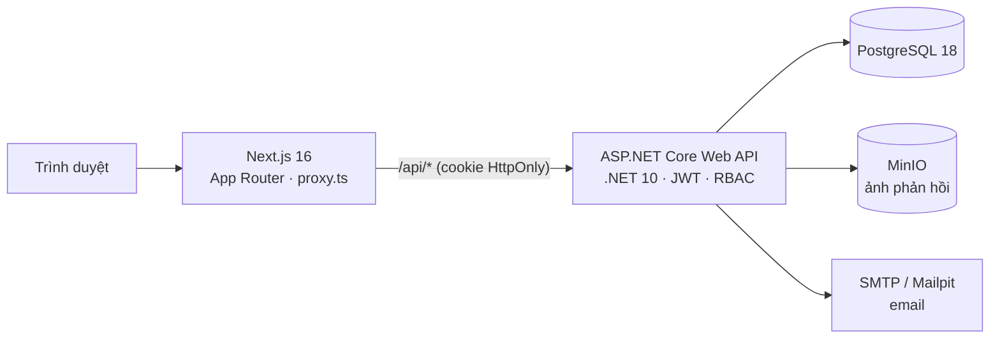

# Cocoon CRM

[](apps/web)
[](src)
[](db/schema.sql)
[](LICENSE)

Hệ thống quản lý quan hệ khách hàng cho cửa hàng mỹ phẩm Cocoon: hồ sơ khách hàng, phản hồi sản phẩm, khảo sát, báo cáo thống kê và gợi ý sản phẩm theo nhu cầu. Đồ án môn Hệ thống thông tin doanh nghiệp (841065), Trường Đại học Sài Gòn.

## Chức năng

Bốn cổng theo vai trò. Mọi quyền và quyền sở hữu dữ liệu được ASP.NET Core kiểm tra lại ở từng request; giao diện chỉ ẩn bớt những gì người dùng không được làm.

| Vai trò | Chức năng chính |
| --- | --- |
| **Khách hàng** | Đăng ký và chọn nhu cầu, đăng nhập, quên mật khẩu; sửa hồ sơ và quyền đồng ý dữ liệu; xem đơn hàng, đánh giá sản phẩm đã mua kèm tối đa 5 ảnh; theo dõi phản hồi và trả lời của cửa hàng; làm khảo sát được gửi tới; nhận gợi ý sản phẩm kèm lý do; thông báo trong ứng dụng |
| **Nhân viên** | Xử lý và trả lời phản hồi được giao; xác nhận và giao đơn hàng |
| **Quản lý** | Tổng quan KPI; thêm, sửa, khóa, xóa khách hàng, tìm kiếm không dấu, xuất CSV; tiếp nhận, phân công, trả lời và đóng phản hồi; soạn khảo sát 4 loại câu hỏi, gửi theo phân khúc (xem trước số người nhận), thống kê kết quả; báo cáo nhóm tuổi, giới tính, nhu cầu và phân tích đánh giá; sản phẩm và kế hoạch gợi ý |
| **Quản trị viên** | Cổng riêng tại `/admin` với bố cục và màu sắc tách biệt; tạo tài khoản nội bộ, phân quyền, khóa, xóa |

Các quy tắc nghiệp vụ chính:

- **Phản hồi** đi theo luồng `New → Accepted → Assigned → Replied → Closed`. Chuyển trạng thái sai trả `409`, lịch sử phân công được giữ lại.
- **Khảo sát:** mỗi khách nộp một lần, có ràng buộc unique trong CSDL. Chỉ người nhận được mở khảo sát; khảo sát đã có câu trả lời thì không sửa được câu hỏi.
- **Tài khoản:**
  - Đăng nhập sai 5 lần thì tạm khóa 15 phút.
  - Tài khoản bị khóa, bị xóa hoặc đổi vai trò sẽ bị từ chối ngay ở request kế tiếp.
  - Luôn giữ ít nhất một Admin đang hoạt động.
- **Lưu vết:** xóa mềm cho khách hàng, tài khoản, sản phẩm và khảo sát; thao tác tài khoản được ghi vào nhật ký hoạt động.

## Kiến trúc



| Thành phần | Công nghệ |
| --- | --- |
| Frontend | Next.js 16, React 19, TypeScript, Tailwind CSS 4, shadcn/ui, TanStack Query, React Hook Form + Zod, Recharts |
| Backend | ASP.NET Core Web API (.NET 10), EF Core 10 code-first, FluentValidation, Serilog, OpenAPI + Scalar |
| CSDL | PostgreSQL 18, migration EF Core, 4 view phân tích |
| Hạ tầng | Docker Compose: `db`, `api`, `minio`, `mailpit` |
| Kiểm thử | xUnit với database riêng `cocoon_tests`; Node test runner và Testing Library cho frontend |

Trình duyệt chỉ nói chuyện với Next.js. Next.js chuyển `/api/*` sang API, cùng origin nên token nằm trong cookie HttpOnly. Frontend không truy cập CSDL.

```text
apps/web/                 Next.js: route group (public), (customer), (staff), (manager), (admin)
src/Cocoon.Api/           Controller /api/v1, xác thực, phân quyền, lệnh seed
src/Cocoon.Application/   Contract và DTO
src/Cocoon.Domain/        Entity, enum, máy trạng thái
src/Cocoon.Infrastructure/ DbContext, migration, service nghiệp vụ, email, lưu trữ ảnh
tests/                    Test backend (xUnit) và test client API
db/                       schema.sql, openapi.json, SQL kiểm chứng, sao lưu và phục hồi
scripts/                  Khởi tạo .env, EF, sao lưu và phục hồi
```

## Chạy trên máy

Cần Docker Desktop (Linux containers) và Node.js 24 LTS. Không cần cài .NET SDK: mọi lệnh `dotnet` chạy trong container `api`.

### 1. Tạo `.env` và khởi động backend

```powershell
powershell -NoProfile -File scripts/init-local-env.ps1
docker compose up -d --build
docker compose exec api sh scripts/ef.sh database update -p src/Cocoon.Infrastructure -s src/Cocoon.Api
```

Script tạo `.env` từ `.env.example`, sinh ngẫu nhiên mật khẩu DB, MinIO và khóa JWT, và không in các giá trị đó ra màn hình. Nếu `.env` đã tồn tại thì giữ nguyên. Không đưa `.env` vào Git.

### 2. Nạp dữ liệu demo

```powershell
docker compose exec api dotnet build
docker compose exec api dotnet run --project src/Cocoon.Api --no-build --no-launch-profile -- seed-v3
```

`seed-v3` nạp toàn bộ dữ liệu demo: tài khoản, sản phẩm, đơn hàng, phản hồi, khảo sát và kế hoạch gợi ý. Lệnh chỉ chạy ở môi trường Development với database `cocoon` trong Compose, không xóa dữ liệu có sẵn và chạy lại nhiều lần vẫn an toàn. Chi tiết ở [SEED_V1](db/SEED_V1.md), [SEED_V2](db/SEED_V2.md) và [SEED_V3](db/SEED_V3.md).

### 3. Chạy frontend

```powershell
cd apps/web
npm ci --ignore-scripts
npm run dev
```

| Địa chỉ | Nội dung |
| --- | --- |
| <http://localhost:3000> | Ứng dụng web |
| <http://localhost:3000/admin/login> | Đăng nhập quản trị viên |
| <http://localhost:5080/swagger/> | Tài liệu API |
| <http://localhost:8025> | Mailpit, hộp thư nhận email khi chạy trên máy |

Các cổng chỉ mở trên `127.0.0.1`. PostgreSQL dùng cổng `5433` để không đụng bản PostgreSQL cài sẵn trên Windows; mọi cổng đổi được trong `.env`.

### Tài khoản demo

Mật khẩu chung `Demo@12345`. Chỉ dùng cho môi trường demo trên máy.

| Email | Vai trò |
| --- | --- |
| `admin@cocoon.demo` | Quản trị viên |
| `manager@cocoon.demo` | Quản lý |
| `staff1@cocoon.demo`, `staff2@cocoon.demo` | Nhân viên |
| `customer01@cocoon.demo` … `customer80@cocoon.demo` | Khách hàng |

`customer81` và `customer82` bị khóa sẵn, `customer83` đã xóa mềm, dùng để thử các trường hợp bị từ chối.

## Kiểm thử

```powershell
docker compose exec api dotnet test            # backend, tự tạo database cocoon_tests

cd apps/web
npm test
npm run lint
npm run typecheck
npm run build
```

Test backend chạy trên database riêng, mỗi test rollback transaction của mình, không đụng database `cocoon`. Số liệu báo cáo đối chiếu được bằng [`db/verify-reports.sql`](db/verify-reports.sql) và [`db/verify-analytics.sql`](db/verify-analytics.sql).

## Cơ sở dữ liệu

- Lịch sử schema chỉ đi qua EF Core migration. [`db/schema.sql`](db/schema.sql) được xuất từ migration, dùng để dựng database mới:

  ```powershell
  docker compose exec api sh scripts/ef.sh migrations script -p src/Cocoon.Infrastructure -s src/Cocoon.Api --output db/schema.sql
  ```

- Các view phân tích phục vụ gợi ý và báo cáo được mô tả ở [ANALYTICS_VIEWS](db/ANALYTICS_VIEWS.md).

## Sao lưu và phục hồi

```powershell
powershell -File scripts\backup-db.ps1
powershell -File scripts\restore-db.ps1
```

- **Sao lưu** chạy `pg_dump` trong container `db`, ghi file `.dump` kèm file kiểm kê vào `./backups`, giữ 7 bản gần nhất.
- **Phục hồi** luôn tạo database mới, rồi đối chiếu bảng, view, số dòng, index, ràng buộc và lịch sử migration với kiểm kê lúc sao lưu. Kết quả là PASS hoặc FAIL.
- Script từ chối ghi đè database chính. Chi tiết ở [BACKUP_RESTORE](db/BACKUP_RESTORE.md).

## Giấy phép

Phát hành theo giấy phép [MIT](LICENSE).
